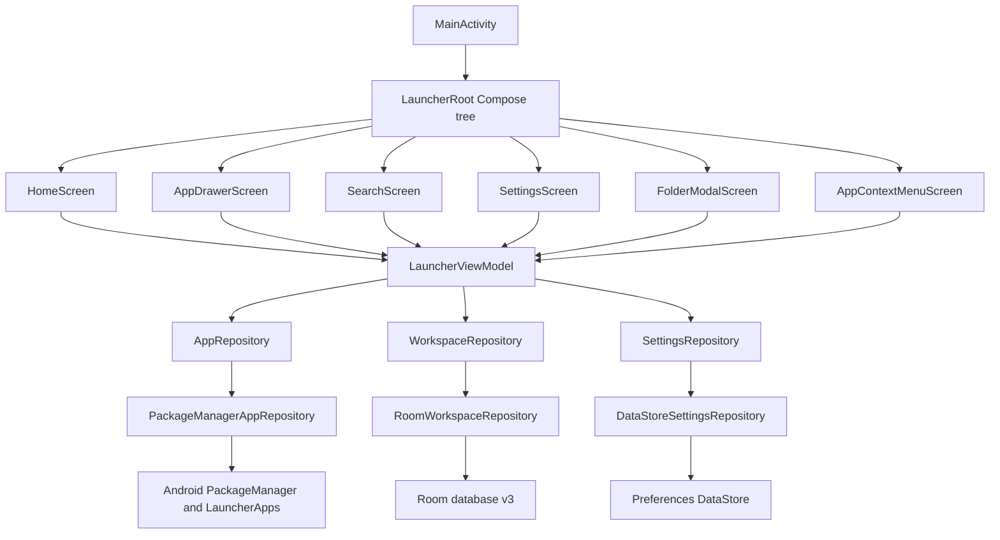
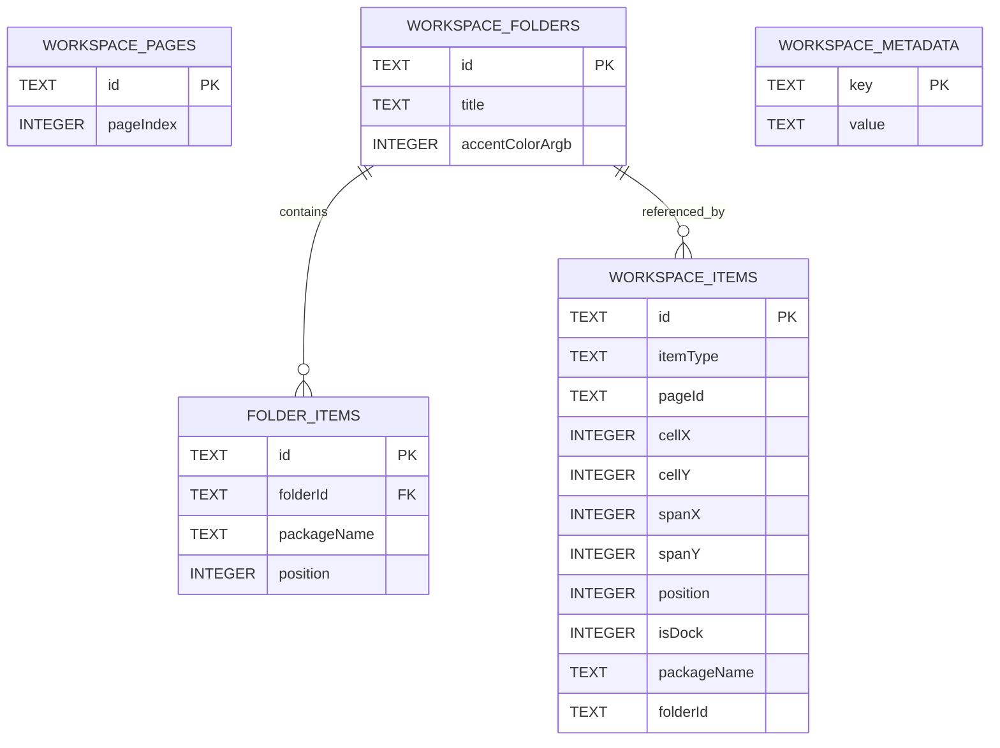

# Architecture

This document describes the architecture that exists on the `migration-orca` branch. It does
not describe planned widget or icon-engine internals as if they were implemented.

## 1. Architectural style

Albkestrel Launcher is a single-module Android application using:

- Kotlin.
- Jetpack Compose and Material 3 for UI.
- An `AndroidViewModel` as the UI state holder.
- Domain repository interfaces.
- Data-layer implementations backed by Android `PackageManager`, Room, and DataStore.
- Manual dependency composition in the `Application` class.

There is no dependency-injection framework, navigation library, network client, or background
service in the launcher code.

## 2. High-level structure



The composition root is `AlbkestrelApplication`. It creates lazy singletons for the database and
the three repositories. `LauncherViewModel` receives the `Application`, casts it to
`AlbkestrelApplication`, and exposes the repositories plus a combined UI state.

## 3. UI layer

### 3.1 Activity and root

`MainActivity` is a `ComponentActivity` with a single `LauncherViewModel`. It:

- Calls `enableEdgeToEdge()`.
- Collects `uiState` with `collectAsStateWithLifecycle`.
- Applies `AlbkestrelTheme`.
- Delegates to `LauncherRoot`.
- Handles `onNewIntent()` by calling `viewModel.onHomeIntentReceived()`.

`LauncherRoot` renders `HomeScreen` as the base layer and then renders overlays with
`AnimatedVisibility`. Overlays are mutually exclusive because they derive from one sealed state.

### 3.2 Overlay state

```kotlin
sealed interface LauncherOverlay {
    object None
    object AppDrawer
    object Search
    object Settings
    object PrototypeInfo
    data class FolderExpanded(val folder: WorkspaceFolder)
    data class AppContextMenu(val app: LauncherApp, val anchorPosition: Offset)
}
```

The state machine is intentionally small:

- `setOverlay` changes the active overlay.
- `closeOverlay` returns to `None`.
- Home intent closes an overlay first, then returns to page 0.
- Folder expansion refreshes its folder reference from the latest database flow.
- A package refresh dismisses a context menu for a package that disappeared.

### 3.3 Screens

| Screen | Responsibility |
| --- | --- |
| `HomeScreen` | Wallpaper, clock/battery card, mock weather, workspace grid, second glance page, dock, page indicator |
| `AppDrawerScreen` | Local drawer query, category tabs, app grid, loading/empty states |
| `SearchScreen` | Auto-focused search, suggested apps, matching results, empty states |
| `SettingsScreen` | Icon size, grid density, theme, animation speed, haptics, dock labels |
| `FolderModalScreen` | Folder title editing, app grid, dismiss behavior |
| `AppContextMenuScreen` | Anchored popup, action policy, dismissal, action routing |
| `PrototypeInfoDialog` | Explicit scope and mock-data disclosure |

Home and dock callbacks route through `LauncherViewModel`. Screens do not access
`PackageManager`, Room, or DataStore directly.

## 4. Domain layer

The domain layer contains platform-independent models, repository contracts, search helpers, and
context-menu policy.

### 4.1 Models

- `LauncherApp` — installed or stale app reference, label, package/activity identity, icon, category,
  system flag, installed flag.
- `WorkspaceItem` — coordinate plus app or folder reference.
- `WorkspaceFolder` — title, accent color, resolved apps.
- `WorkspacePage` — page identity and index.
- `LauncherSettings` — persisted user preferences.
- `AppContextMenuAction` / `AppShortcut` — context-menu action and shortcut records.

`LauncherApp.icon` is an `ImageBitmap`, so the UI never touches Android `Drawable` objects.

### 4.2 Repository contracts

| Interface | Contract |
| --- | --- |
| `AppRepository` | Package-change flow, load apps, find app, launch app, open details, uninstall, discover/launch shortcuts |
| `WorkspaceRepository` | Observe pages/items/folders, initialize, rename folder, move/add/remove item, delete folder, add app to folder, remove app from workspace |
| `SettingsRepository` | Observe settings and update individual preferences |

The contracts are Android-agnostic except for types already modeled in the domain.

### 4.3 Search

`AppSearch` is a pure object with case-insensitive label filtering, category filtering, and
stable alphabetical sorting by label and package name. It is shared by the drawer and search
overlay.

### 4.4 Context-menu policy

`AppContextMenuPolicy` builds the ordered action list:

1. App info.
2. Discovered shortcuts for the exact package.
3. Pause app, only if `isPauseSupported()` is true.
4. Widgets, only if `isWidgetSupportAvailable()` is true.
5. Remove from launcher.
6. Uninstall, unless the app is a system app.

Uninstalled apps produce no actions. The capability methods return `false` today because no public
pause API or real widget host exists.

## 5. Data layer

### 5.1 PackageManager repository

`PackageManagerAppRepository` is the Android integration point for installed apps.

**Discovery**

- Queries `Intent.ACTION_MAIN` with `CATEGORY_LAUNCHER`.
- Uses the API 33 `ResolveInfoFlags` overload when available, otherwise the deprecated overload.
- Loads labels and icons, caches icon `ImageBitmap`s, maps platform categories when available.
- Maps activities through `InstalledAppsMapper`, which excludes the launcher itself, collapses
  multiple activities per package, sorts deterministically, and assigns stable IDs.

**Cache invalidation**

- Registers a non-exported receiver for package added/removed/changed/replaced broadcasts.
- The receiver uses the application context and lives for the process lifetime.
- Invalidation clears the app cache and icon cache, then emits through `packageChanges`.
- A transient query failure is not cached, so a later refresh can retry.

**Launching**

- Uses an explicit `ComponentName` for the discovered launcher activity.
- Falls back to `PackageManager.getLaunchIntentForPackage`.
- Returns `false` instead of crashing when the intent cannot be built or started.

**System actions**

- App info opens `Settings.ACTION_APPLICATION_DETAILS_SETTINGS`.
- Uninstall opens `Intent.ACTION_DELETE` after re-checking installation and system-app status.
- Shortcuts use `LauncherApps` only on API 25+, with shortcut-host permission.

### 5.2 Room repository

`RoomWorkspaceRepository` owns persistence behavior.

**Bootstrap**

- Guarded by a `Mutex`.
- Runs inside a Room transaction.
- Skips all work when `workspace_bootstrap_complete` is `1`.
- Creates structural pages if missing.
- Removes only known legacy prototype package names.
- Seeds dock, home apps, and default folders only on a fresh database or after legacy cleanup.
- Preserves existing user placements, including intentionally empty areas.
- Writes the bootstrap marker in the same transaction as cleanup and seeding.

**Observation**

- `observeWorkspaceItems` combines item rows with resolved folders and the current app list.
- Missing packages become dimmed placeholder `LauncherApp` entries with `isInstalledApp = false`.
- Folder observation resolves folder items against the current app map.

**Mutation**

- `moveItem` and `addItem` validate duplicate IDs and rectangular collisions in the target
  container.
- `removeItem` cascades to an empty folder reference.
- `removeAppFromWorkspace` removes top-level and folder references, deletes folders left empty, and
  never uninstalls the Android package.

### 5.3 Database schema



Database version is `3`. Migrations:

- `1 → 2` recreates `folder_items` with a cascading foreign key and index.
- `2 → 3` adds `workspace_metadata` and marks pre-v3 databases so an empty workspace is not
  reseeded.

Schemas are exported to `app/schemas/`.

### 5.4 DataStore repository

`DataStoreSettingsRepository` stores preferences in the `albkestrel_launcher_settings` DataStore.
It migrates from the legacy `albkestrel_launcher_prefs` SharedPreferences file. Invalid enum names
and out-of-range grid values fall back to defaults.

## 6. ViewModel responsibilities

`LauncherViewModel` is the single UI state owner. It:

- Loads apps immediately and on package changes.
- Combines app state, workspace state, and preference state into `LauncherUiState`.
- Owns overlay state and Home-intent collapse behavior.
- Owns page index, search query, and drawer category.
- Owns haptic feedback with API-level fallbacks.
- Dispatches app launch, folder, context-menu, and settings actions.
- Dismisses stale context menus after package refresh.
- Exposes repository references to the context-menu composable for shortcut resolution.

The ViewModel does not render UI and does not build Android `Intent`s directly; those stay in the
data layer.

## 7. Compose design system

- `LuminousSurface` is the shared translucent surface with a gradient border.
- `LivingAppIcon` renders press scaling, a real icon or vector fallback, optional label, and optional
  badge.
- `FolderIcon` renders a folder preview.
- `AlbkestrelTheme` maps theme mode and dynamic color into Material 3 color schemes.
- `Color.kt`, `Type.kt`, and `LuminousSurface.kt` own the visual tokens.

See [DESIGN_SYSTEM.md](docs/DESIGN_SYSTEM.md).

## 8. Threading and flow

- Package queries run through `Dispatchers.IO` in the ViewModel.
- Room observation flows use `flowOn(Dispatchers.IO)`.
- The database transaction is suspending.
- UI state is a `StateFlow` collected with lifecycle awareness.
- Haptics and `startActivity` run on the caller thread and catch platform exceptions.
- Shortcut discovery currently occurs while the context menu composes; this is a known performance
  risk recorded in [TODO.md](TODO.md).

## 9. Error handling

The code favors safe degradation:

- Package-query failure returns an empty list without caching the failure.
- Missing launch intent returns `false`.
- Missing activity details or uninstall targets return `false`.
- Shortcut APIs return an empty list or `false` on unsupported versions, missing permission, or
  exceptions.
- Missing packages render as dimmed, non-launchable entries.
- Haptic failures are ignored.
- `AppSearch` and settings parsing use deterministic fallbacks.

The launcher does not currently have a crash-reporting or telemetry pipeline.

## 10. Android boundaries

| Boundary | Current behavior |
| --- | --- |
| HOME role | Declared in the manifest; user selects the launcher in system settings |
| Package visibility | `<queries>` limited to `MAIN`/`LAUNCHER` intents |
| App removal | Official `ACTION_DELETE`; user confirmation owned by Android |
| App details | Official application-details settings screen |
| Shortcuts | `LauncherApps` API 25+ with host-permission check |
| Widgets | Not implemented; no `AppWidgetHost` |
| Root/system APIs | Not used |
| Network | No network code or source-manifest permission |

## 11. Testability

- Domain policy and search are pure Kotlin.
- `PackageManagerAppRepository` has testable intent-building and action guards.
- `RoomWorkspaceRepository` is tested with an in-memory Room database.
- `LauncherViewModel` is tested with coroutine test dispatchers and a Robolectric application.
- `LivingAppIcon` click and long-click semantics are tested through Robolectric/Compose.
- Bounded icon-cache behaviour and clock-ticker timing are unit tested.
- `FolderIcon` and extended `LivingAppIcon` semantics/48 dp targets are Robolectric tested.
- Compose test tags exist on key surfaces. An `app/src/androidTest` accessibility suite exists and
  compiles, but it has not been executed without a device.

## 12. Known architectural deviations and risks

1. Manual dependency composition is simple but scales poorly if repositories multiply.
2. `LauncherViewModel` is large and owns UI state, persistence coordination, haptics, and actions.
3. Shortcut discovery runs on `Dispatchers.IO` through `produceState` in the working tree; it still
   belongs to the composition lifecycle rather than a long-lived state flow.
4. The icon cache is bounded with `LruCache` in the working tree and cleared on package invalidation;
   it has not been profiled on a low-memory device.
5. Real notification badges are not wired.
6. Dynamic color and wallpaper dim are persisted but not exposed in Settings.
7. Firebase/AppCheck dependencies have been removed in the working tree; the merged debug manifest
   is clean.
8. No instrumentation test has been executed against Android system interactions; the suite compiles
   only.
9. Bundled JPEGs and derived launcher mipmaps have unresolved provenance and licensing.
