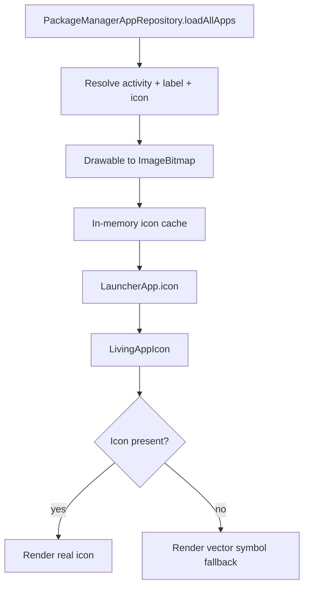

# Icon Engine

> Status: the current icon handling is implemented. The icon-pack engine is **planned** (Phase 1.4)
> and does not exist. Do not describe icon-pack support, themed icons, or per-app overrides as
> available.

## 1. What exists today

### Rendering path

Key files:

| File | Responsibility |
| --- | --- |
| `data/repository/PackageManagerAppRepository.kt` | Loads real icons, caches `ImageBitmap`s, invalidates on package changes |
| `data/repository/InstalledAppsMapper.kt` | Assigns stable app identity and fallback symbol |
| `core/designsystem/LivingAppIcon.kt` | Renders icon, gradient background, fallback, badge, label, press state |
| `core/designsystem/FolderIcon.kt` | Renders folder preview from member apps |
| `domain/model/AppModels.kt` | `LauncherApp.icon`, `iconSymbol`, `IconSize` |

### Behavior

- Real launcher icons are read from `ResolveInfo.activityInfo.loadIcon(packageManager)`.
- The `Drawable` is converted to an `ImageBitmap` once and cached by package name.
- The UI only handles `ImageBitmap`; it never receives an Android `Drawable`.
- If no bitmap is available, `LivingAppIcon` falls back to a Material vector symbol derived from the
  app's `iconSymbol`.
- The icon sits on a deterministic gradient background derived from the package name.
- A specular highlight and optional notification badge are drawn over the icon.
- Labels are single-line with ellipsis and can be hidden for the dock.
- Press scaling uses `0.90f` via `pointerInput`.
- Icon size is user-selectable: 48dp, 56dp, 64dp.

### Cache invalidation

- Package added/removed/changed/replaced broadcasts clear the app cache and the icon cache.
- The cache is process-scoped and bounded by a heap-derived `LruCache` in the Phase 1.2.1 working
  tree; failed decodes are not cached.
- The cache is not persisted, so icons reload after process death.

## 2. Known limitations

1. **Memory budget not profiled.** The cache is bounded, but its behaviour on low-memory devices has
   not been measured.
2. **No icon pack support.** There is no `appfilter.xml` parsing, no drawable lookup, no pack UI.
3. **No per-app overrides.** A user cannot choose a different icon for one app.
4. **No themed icons.** Android 13+ monochrome/themed icon support is not used.
5. **No adaptive-icon treatment.** Legacy and adaptive icons are rendered as provided by the
   platform; the launcher does not normalize shapes.
6. **No visual regression tests.** Icon appearance is not covered by screenshots or golden tests.
7. **No per-size visual validation.** Icon quality at each size has not been reviewed in a recorded
   per-size device pass.

Item 1 is recorded in [../TODO.md](../TODO.md) as a performance task, not a Phase 1.4 feature.
Click and long-click semantics are implemented and covered by `LivingAppIconAccessibilityTest`.

## 3. Proposed Phase 1.4 architecture

Phase 1.4 is the **Icon Appearance Engine**. It should be reviewed through
[ADR-002](decisions/ADR-002-LAUNCHER-ARCHITECTURE.md) and a dedicated ADR before implementation.

### 3.1 Goals

- Discover and parse at least one real icon-pack format.
- Allow per-app icon overrides.
- Support adaptive and themed icons where the platform allows.
- Preserve a deterministic fallback to the real `PackageManager` icon.
- Bound memory use.
- Keep the UI layer platform-agnostic.

### 3.2 Proposed components

| Component | Layer | Responsibility |
| --- | --- | --- |
| `IconPackRepository` | data | Discover installed icon packs and expose metadata |
| `IconPackParser` | data | Parse `appfilter.xml` and drawable resources |
| `IconResolver` | domain/data | Resolve the best icon for an app from overrides, pack, then system |
| `IconOverrideStore` | data | Persist per-app overrides in DataStore or Room |
| `IconCache` | data | Bounded memory cache with eviction |
| `ThemedIconAdapter` | platform | Apply monochrome/tinted treatment where supported |
| `IconSettingsScreen` | UI | Select pack, override an icon, reset to system |

### 3.3 Resolution order

1. Explicit per-app override selected by the user.
2. Matching icon from the selected icon pack.
3. Themed/monochrome icon, if the user enabled it and the platform supports it.
4. Real `PackageManager` icon.
5. Deterministic vector symbol fallback.

Every step must be testable without a device. Fallbacks must never produce a blank icon.

### 3.4 Caching

- Use an LRU or size-bounded cache.
- Key by package, activity, icon source, size, and theme state.
- Clear on package change, pack change, and override change.
- Avoid retaining `Drawable` or `Activity` references.
- Measure memory with a large installed-app set.

### 3.5 Icon pack format

Start with the de-facto Android icon-pack format:

- `appfilter.xml` maps package/activity to drawable names.
- Drawables live in the pack's resources.
- Support component-specific entries before package-wide entries.
- Tolerate malformed XML and missing drawables by falling back.

Do not claim support for multiple pack formats until each is implemented and validated.

### 3.6 Themed icons

- Android 13+ exposes themed icon APIs through `LauncherApps` and adaptive icon metadata.
- Only apply when the user opts in and the platform supports it.
- Provide a clear fallback when a provider has no monochrome layer.
- Do not tint arbitrary colored icons into unreadable shapes.

### 3.7 Settings surface

Phase 1.4 may add:

- Icon pack selection (including "System").
- Per-app override entry point.
- Reset-all-overrides action.
- Themed icon toggle where supported.

Only expose controls that are wired and tested. The current Settings screen already omits persisted
dynamic color and wallpaper dim because they have no controls; do not repeat that pattern.

## 4. Testing strategy

Unit tests:

- Pack discovery and metadata parsing.
- `appfilter.xml` parsing, including malformed input.
- Resolution precedence.
- Override persistence and reset.
- Cache eviction and key separation.
- Fallback determinism.

Instrumentation/device:

- Real icon pack installed and applied.
- Missing drawable fallback.
- Adaptive and themed icon rendering on API 33+.
- Memory behavior with many apps.
- Visual comparison across 48/56/64dp.

## 5. Security and privacy

- Icon packs are third-party APKs; query only what is needed.
- Do not execute code from an icon pack.
- Do not request broad storage access.
- Parse XML defensively; reject oversized or malformed input.
- Do not upload icon inventories or app lists.

## 6. Non-goals

- Designing a private, non-standard icon format.
- Selling or bundling icon packs.
- Replacing the system icon theme globally.
- Changing another app's icon outside the launcher.
- Claiming themed-icon support before it is implemented and validated.

## 7. Exit criteria

Phase 1.4 is complete only when:

- At least one real icon pack works end to end.
- Per-app overrides persist and can be reset.
- Missing icons fall back deterministically.
- Caching is bounded and measured.
- Settings exposes only working controls.
- Unit tests cover parsing, precedence, and eviction.
- A physical device validates visual output at all icon sizes.
