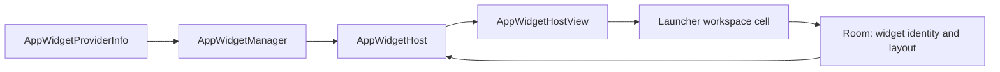
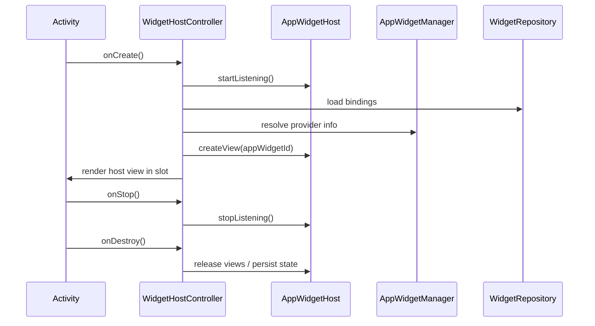

# Widget Architecture

> Status: **proposed design**. No third-party widget hosting exists in the codebase. This document
> describes the intended Phase 1.3 architecture so that implementation can be reviewed before it
> starts. Do not treat any section as implemented.

## 1. Current state

What exists today:

- `WorkspaceItemEntity.itemType` can represent a `WIDGET_SLOT` row.
- The workspace renderer has an empty branch for widget slots.
- The context-menu policy contains a **Widgets** action gated by
  `isWidgetSupportAvailable()`, which returns `false`.
- Compose cards labelled "glance" (weather, media, wellbeing) are **not** Android widgets. They are
  in-app mock surfaces.

What does not exist:

- `AppWidgetHost` or `AppWidgetHostView`.
- Widget provider discovery or a widget picker.
- `BIND_APPWIDGET` permission handling.
- Widget resize, persistence of widget identity, or lifecycle restoration.
- Any test or device validation for widgets.

An empty widget slot is not widget support. The **Widgets** menu action must stay hidden until the
capability is real.

## 2. Platform model

Android widget hosting is an OS-level contract:



Key platform facts:

- A host app allocates a host id with `AppWidgetHost.allocateAppWidgetId()`.
- Binding a provider requires the user to approve it, usually through
  `AppWidgetManager.requestPinAppWidget()` or the system bind flow.
- `BIND_APPWIDGET` is a signature/privileged permission and is not granted to normal apps. A normal
  launcher must not assume it holds it.
- `requestPinAppWidget` lets a user pin a supported widget without the launcher holding
  `BIND_APPWIDGET`, but it is not a general picker and depends on provider support and launcher
  role.
- A custom in-app widget picker that binds arbitrary providers requires the platform bind flow and
  must handle denial gracefully.
- Widget views are remote views inflated by the host. They must be created, updated, and released
  with the host lifecycle.

## 3. Proposed architecture

### 3.1 Components

| Component | Layer | Responsibility |
| --- | --- | --- |
| `WidgetHostController` | data/platform | Owns the `AppWidgetHost`, host id, bind/allocate/release calls |
| `WidgetProviderRepository` | data | Lists providers, filters unsupported ones, exposes metadata |
| `WidgetRepository` | domain contract | Persists widget bindings and placement |
| `WidgetBinding` | domain model | App widget id, provider component, page, cell, span |
| `WidgetHostViewFactory` | UI/platform | Creates and configures `AppWidgetHostView` |
| `WidgetSlot` composable | UI | Reserves grid space and hosts the Android view |
| `WidgetPickerScreen` | UI | Presents only providers that can actually be bound |

### 3.2 Host lifecycle



Rules:

- One host id per launcher installation, persisted so widget bindings survive process death.
- `startListening()` while the launcher is visible; `stopListening()` when it is not.
- Every allocated widget id must eventually be deleted or intentionally persisted.
- Orphaned ids (provider uninstalled, binding failed) must be released and their rows cleaned.
- Widget views must not leak activity context.

### 3.3 Persistence

Proposed Room additions (not implemented):

```text
widget_bindings
  id                TEXT PK
  appWidgetId       INTEGER UNIQUE
  providerPackage   TEXT
  providerClass     TEXT
  pageId            TEXT
  cellX, cellY      INTEGER
  spanX, spanY      INTEGER
  createdAt         INTEGER
```

Placement reuses the existing workspace coordinate space. A widget occupies a rectangle and must
participate in the same collision checks as apps and folders.

### 3.4 Provider discovery

- Query `AppWidgetManager.getInstalledProviders()`.
- Filter providers that cannot be hosted on the current API level.
- Show label, icon, minimum size, resize mode, and configuration requirement.
- Do not list a provider if the binding flow cannot succeed.
- Handle `android:configure` activities: some providers require configuration before the view is
  valid.

### 3.5 Rendering

- Render through `AppWidgetHostView`, not a reimplementation of the provider's remote views.
- Use `AndroidView` inside the Compose slot, with stable keys.
- Apply the launcher's grid size to the widget's minimum dimensions honestly; do not stretch a
  widget beyond what the provider supports without a resize path.
- Respect `WidgetCategory` (home screen vs keyguard). This launcher only targets home screen.

### 3.6 Resize and reflow

- Honor `resizeMode` flags.
- Persist updated spans after a resize.
- Re-run collision checks; reject or reflow placements that overlap.
- Recompute layout on orientation and font-scale changes.

### 3.7 Refresh and change handling

- Listen for `ACTION_APPWIDGET_UPDATE`, provider changes, package removal, and package replacement.
- Refresh a widget view when its provider package changes.
- Remove bindings when the provider is uninstalled.
- Do not crash if a provider disappears between listing and binding.

## 4. Failure modes

| Failure | Required behavior |
| --- | --- |
| Bind permission denied | Show an explanation, keep the slot empty, do not fake a widget |
| Provider removed | Release the view and delete the binding row |
| `createView` returns null | Mark the slot unavailable and offer removal |
| Configuration activity cancelled | Do not persist an unconfigured widget |
| Host id invalid | Allocate a new id and reconcile stored bindings |
| Process death | Restore bindings from Room and recreate views |
| Resize collision | Reject or reflow; never overlap items |
| Unsupported API | Hide widget entry points entirely |

## 5. Security and privacy

- No root or system-only API.
- No `BIND_APPWIDGET` assumption.
- Widgets run in the host process through remote views; the launcher must not grant them extra
  privileges or inject data.
- Do not add network permissions for widget support.
- Do not fetch remote widget content outside the provider's own process contract.
- Treat widget configuration intents as untrusted input.

## 6. Testing strategy

Unit-testable:

- Binding persistence and reconciliation.
- Collision and resize math.
- Provider filtering.
- Orphan cleanup.
- Failure-state transitions.

Requires instrumentation or a device:

- Actual bind approval flow.
- `AppWidgetHostView` inflation.
- Provider configuration activity.
- Resize gestures.
- Process-death restoration.
- Launcher restart with existing widgets.
- Provider uninstall while the launcher is visible.

## 7. Phased delivery proposal

1. **Host foundation** — host id, lifecycle, one hard-coded test widget in a debug-only surface.
2. **Persistence** — binding rows, restore after restart, orphan cleanup.
3. **Picker** — provider list and bind flow with honest failure states.
4. **Placement** — grid slot, collision checks, resize.
5. **Change handling** — provider updates and removal.
6. **Menu integration** — enable the **Widgets** action only after 1–5 pass device validation.

Each step must be independently reviewable. Do not merge a picker that cannot bind.

## 8. Exit criteria

Phase 1.3 is complete only when:

- A real third-party widget can be added, rendered, persisted, restored, resized, and removed.
- Bind denial is handled without fake UI.
- Provider removal cleans up without orphaned rows.
- The **Widgets** action appears only when the host can service it.
- Unit tests cover state and persistence; device validation covers rendering and lifecycle.

## 9. Explicit non-goals

- Replacing the system launcher's widget picker outside this app.
- Hosting widgets without user approval.
- Root/system-only widget binding.
- Reimplementing provider remote views in Compose.
- Treating the existing mock glance cards as third-party widgets.

See [ADR-003](decisions/ADR-003-WIDGET-HOST.md) for the decision record.
